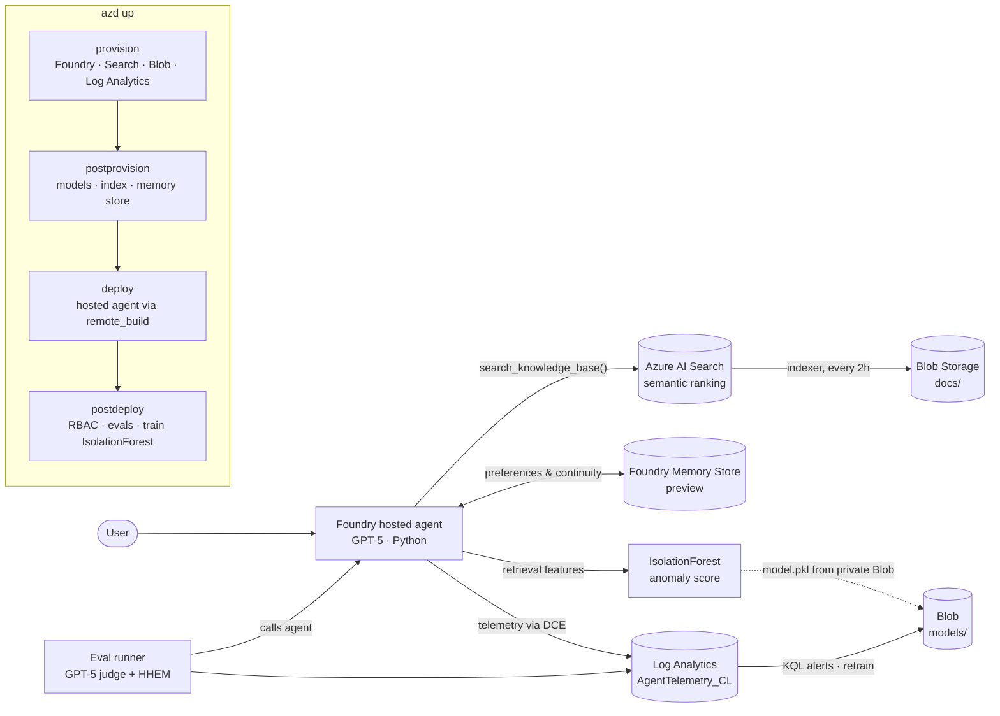

# azd-foundry-search-agent

[](https://codespaces.new/Metafiziks/azd-foundry-search-agent)

An [Azure Developer CLI](https://aka.ms/azd) template that deploys an **Azure AI Foundry hosted agent** over your own documents. Ask a question, get a synthesized answer with cited source links. One `azd up` provisions everything, runs an LLM-judged evaluation suite, and trains an anomaly detector on the agent's own retrieval telemetry. One `azd down --purge` removes it.

```
Agent: What should a floor supervisor do when equipment fails?

Here's a practical sequence broken down by safety, quality, and maintenance...

Sources:
- [Lockout Tagout Procedure](https://....blob.core.windows.net/docs/safety/lockout_tagout_procedure.txt)
- [Hydraulic Press Troubleshooting Guide](https://....blob.core.windows.net/docs/maintenance/hydraulic_press_troubleshooting.txt)
```

## Architecture



The agent runs entirely in Foundry hosting: no container registry or Container Apps environment. Its managed identity gets `Search Index Data Reader`, Foundry/OpenAI roles for memory, and telemetry/model-artifact roles automatically.

**Memory is not the source of truth.** Azure AI Search supplies procedures and citations. Memory Store only supplies scoped continuity (preferences, workflow context), so "I like short answers" can never change a lockout procedure.

## Quick start

**Prerequisites:** [azd](https://learn.microsoft.com/azure/developer/azure-developer-cli/install-azd) with the `microsoft.foundry` extension, [Azure CLI](https://learn.microsoft.com/cli/azure/install-azure-cli), and a subscription with **gpt-5 GlobalStandard quota** in `eastus2` (or set `AZURE_AI_MODEL_NAME`, `AZURE_AI_MODEL_VERSION`, `AZURE_AI_MODEL_CAPACITY` for another model).

```bash
azd extension install microsoft.foundry
git clone https://github.com/Metafiziks/azd-foundry-search-agent && cd azd-foundry-search-agent
azd auth login && az login     # sign in to both as the SAME identity
azd up
```

| Stage | What happens |
|---|---|
| Provision | Foundry account + project, AI Search, Blob Storage |
| Post-provision | Deploys gpt-5 and `text-embedding-3-small`, uploads `docs/`, builds index + indexer, creates the Memory Store (and proves it works) |
| Deploy | Packages and deploys the hosted agent |
| Post-deploy | Grants the agent its roles, waits for RBAC, runs generated evals, trains the anomaly model |

Hosted build, RBAC propagation, and evals take several minutes each. Test it:

```bash
azd ai agent invoke search-agent '{"messages":[{"role":"user","content":"What documents are available?"}]}'
```

The CLI reuses conversation history between invokes; use the portal playground link from `azd up` for a fresh session.

Tear down (the Cognitive Services account is soft-deleted without `--purge`, which blocks reusing the environment name for 48 hours):

```bash
azd down --force --purge
```

## Bring your own documents

Replace `docs/` with your own `.txt`, `.pdf`, `.docx`, or `.md` files (subfolders become metadata), adjust `INSTRUCTIONS` in `src/agent/main.py`, and re-run `azd up` (or `azd deploy` for code-only changes). Sample mode serves **publicly readable** Blob citation URLs, so use it only for public documents. For internal knowledge bases use [Purview-protected mode](guides/purview.md): sensitivity-label-aware retrieval under the signed-in user's own permissions, no public Blob access, no keys.

## Evaluations

Runs automatically after `azd up`, and standalone with `bash scripts/eval.sh` (add `--no-judge` for deterministic metrics only).

| Metric | Threshold | Measured by |
|---|---|---|
| Faithfulness | ≥ 0.60 | GPT-5 judge: claims grounded in reference evidence |
| Answer relevance | ≥ 0.75 | GPT-5 judge |
| Citation recall | ≥ 0.60 | Expected source appeared in citations |
| Keyword recall | ≥ 0.65 | Key phrases from expected answer present |
| p95 latency | ≤ 45,000 ms | Wall-clock agent response |
| Memory recall | case-level | Turn 1 states a preference; turn 2 asks for it back |

Sample mode generates two cases per `.txt` document plus the memory case into `.azure/<env>/evals/`. A failed agent call, a `status=failed` response, or a missing HHEM score fails the run; nothing is quietly counted as passing. After editing `docs/`, regenerate with `python3 scripts/generate_eval_cases.py`.

For quota-constrained subscriptions, tune `EVAL_AGENT_TIMEOUT_SECONDS`, `EVAL_AGENT_ATTEMPTS`, `EVAL_INTER_CASE_WAIT_SECONDS`, `EVAL_WARMUP_ENABLED`, `POSTDEPLOY_EVAL_ARGS` (e.g. `--no-judge`), and `BASELINE_RUNS` (`0` skips extra training passes).

## Memory (Foundry Memory Store, preview)

`postprovision.sh` deploys the embedding model, grants `Foundry User` + `Cognitive Services OpenAI User` to the deployer and the project/account identities, creates the store through `azure-ai-projects>=2.3.0`, and proves it works with an embedding-backed **search** and a chat+embedding-backed **write** before enabling memory (the probe retries 401/403 for up to 15 minutes while roles propagate; `MEMORY_PROBE_RETRY_SECONDS`). `postdeploy.sh` then grants the same roles to the agent's hosting identity.

**Memory Store calls run as the caller**, which at runtime is the agent's hosting identity. Without `Foundry User` on that identity every memory read fails in milliseconds with `Identity(object id: …) does not have permissions for …/agents/read`. A new grant took ~4 minutes to take effect in testing, so `postdeploy.sh` waits `RBAC_PROPAGATION_WAIT_SECONDS` (default 300). At runtime a context provider reads memories before each model call and queues updates after the response.

- **Scope:** default `{{$userId}}`. For local or single-tenant use set `MEMORY_SCOPE=user:{memory_user_id}` + `MEMORY_USER_ID`, or `session:{session_id}` for per-session isolation.
- **Optional by default** (`MEMORY_OPTIONAL=true`): provisioning/runtime failures fall back to RAG-only and the recall eval is **skipped**, not passed. Set `false` to fail fast.
- Writes take 40-60 s, so they always complete in the background. With `MEMORY_OPTIONAL=false` a failed write makes the *next* request fail instead of blocking the current one.
- Don't store secrets, credentials, financial data, or precise location.
- Telemetry columns: `MemoryEnabled_b`, `MemoryReadCount_d`, `MemoryWriteCount_d`, `MemoryLatencyMs_d`, `MemoryStatus_s`.

## ML observability

| Model | Purpose | Where |
|---|---|---|
| Azure AI Search semantic ranker | Rerank retrieved documents | AI Search (Standard) |
| `IsolationForest` | Flag unusual retrieval patterns from a 6-feature vector (score mean/std/entropy, chunk count, reranker mean, search latency) | Private Blob `models/iforest.pkl` |
| `vectara/hallucination_evaluation_model` (HHEM-2.1) | Score answer faithfulness in evals (not memory recall) | HuggingFace, runs in eval process |

`postdeploy.sh` runs the evals plus extra baseline passes, queries real hosted-agent retrieval rows from Log Analytics, trains IsolationForest once ≥10 rows exist, and uploads it to Blob. The agent loads it on its first retrieval after upload; a running instance keeps its cached model until restart. There is no scheduled retraining: run `gh workflow run retrain-observability.yml` manually (30-day lookback by default).

Telemetry lands in `AgentTelemetry_CL` (`RequestId_s`, `RetrievalScoreMean_d`, `RerankerScoreMean_d`, `ChunkCount_d`, `SearchLatencyMs_d`, `HhemScore_d`, `AnomalyScore_d`, `IsAnomaly_b`, `IsBaseline_b`, plus the memory columns above):

```kql
AgentTelemetry_CL
| where TimeGenerated > ago(30d)
| make-series avg_score=avg(RetrievalScoreMean_d) on TimeGenerated step 1h
| extend anomalies=series_decompose_anomalies(avg_score)
| render anomalychart
```

## CI/CD (optional)

```bash
mkdir -p .github/workflows && cp workflows/*.yml .github/workflows/
```

Secrets: `AZURE_CLIENT_ID`, `AZURE_TENANT_ID`, `AZURE_SUBSCRIPTION_ID` (federated credentials). Variables: `AZURE_ENV_NAME`, `AZURE_LOCATION`. `deploy.yml` redeploys on push and re-indexes when `docs/` changes; `run-evals.yml` runs weekly (Mon 06:00 UTC) and on demand; `retrain-observability.yml` is manual-only (needs `LOG_ANALYTICS_WORKSPACE_ID` and `BLOB_ACCOUNT_URL`, set by `postprovision.sh`). Set `KB_ACCESS_MODE=purview` as a repo variable to disable the sample jobs.

## Configuration

Set with `azd env set <NAME> <value>` before `azd up`.

| Variable | Description |
|---|---|
| `AZURE_LOCATION` | Region (default `eastus2`); Search falls back to other regions on capacity errors |
| `AZURE_AI_MODEL_NAME` / `_VERSION` / `_CAPACITY` | Chat model deployment (default gpt-5, `2025-08-07`) |
| `AZURE_AI_EMBEDDING_MODEL_DEPLOYMENT_NAME` | Embedding deployment for Memory Store (default `text-embedding-3-small`) |
| `KB_ACCESS_MODE` | `sample` (default) or `purview` |
| `MEMORY_ENABLED` / `MEMORY_OPTIONAL` | Enable memory / tolerate its failure (default `true` / `true`) |
| `MEMORY_STORE_NAME` / `MEMORY_SCOPE` | Store name and isolation scope template |
| `MEMORY_INCLUDE_STATIC_PROFILE` | Inject profile memories on every request (default `false`: only memory/preference-style questions) |
| `MEMORY_UPDATE_DELAY_SECONDS` | Debounce before writes commit (default `5`) |
| `MEMORY_PROBE_RETRY_SECONDS` | How long provisioning retries the Memory Store probe through RBAC propagation (default `900`) |
| `RBAC_PROPAGATION_WAIT_SECONDS` | Post-deploy wait after granting the agent's roles (default `300`; ~4 min was observed) |
| `EVAL_MEMORY_SETTLE_SECONDS` | Wait between the two memory-recall turns while the background write completes (default `90`) |

azd also sets `AZURE_SEARCH_ENDPOINT`, `AZURE_SEARCH_INDEX`, `FOUNDRY_PROJECT_ENDPOINT`, `AGENT_SEARCH_AGENT_ENDPOINT`, and the Log Analytics/Blob values automatically.

## Live validation

Two separate disposable deployments in November 2026, each removed with `azd down --force --purge` (resource group deleted, Cognitive Services account purged).

| Test | Result |
|---|---|
| Sample `azd up`, fresh environment, current code | Provision + deploy + post-deploy completed in about 1 hour with `BASELINE_RUNS=1` (provisioning took 5.4 min). All 13 generated cases completed: faithfulness 0.96, answer relevance 1.00, citation recall 1.00, keyword recall 0.91, **p95 40.1 s**. The two-turn memory recall case **passed with managed memory** (38 s). |
| Same run, observability | HHEM scored all 12 RAG answers. IsolationForest trained on 34 hosted retrieval samples and uploaded to private Blob; the hosted agent then loaded it and wrote a nonzero anomaly score to Log Analytics. Memory telemetry: 30 reads (avg 0.95 s), 27 completed background writes (avg 34 s, max 61 s), 1 failed write (tolerated in optional mode). |
| Memory failure, reproduced | Removing the hosting identity's `Foundry User` made every memory read fail in 35-220 ms with `Identity(object id: …) does not have permissions for …/agents/read`. A new grant took 3 min 48 s to take effect; `Foundry User` alone was enough for reads and writes. Reads kept working with no roles on the project and account identities (writes were not tested in that state; the template still grants them, per Microsoft's prerequisites). |
| Before the memory fixes (first run) | Failed its own gate: **p95 93.6 s** because strict-mode memory writes (avg 40 s, max 63 s) blocked each response, plus one transient `server_error`. Memory recall passed but took 158 s. |
| Protected Purview retrieval (earlier, separate environment) | The authorized user retrieved the labeled document with a citation; the unauthorized user and unlabeled control received no protected content. Missing delegation and stateful requests were rejected, and anonymous Blob reads were denied. This verified query-time enforcement, not file encryption at rest. Not re-run in the latest session. |

Run 1 used `MEMORY_OPTIONAL=false`; run 2 used the defaults.


## Troubleshooting

| Symptom | Fix |
|---|---|
| `azd deploy` → `Project not found` | The Foundry data plane needs a few minutes after provisioning. Re-run `azd deploy`. |
| Search capacity error | `postprovision.sh` retries `eastus`, `westus2`, and others automatically. |
| `ServiceDeleting` on Search | Re-running `azd up` right after `azd down`; it retries with backoff. Wait and re-run. |
| `azd auth login --check-status` says logged in but `azd up` says *Login expired* | The refresh token expired after 90 days idle. Run `azd auth login` again. |
| Memory eval skipped | Check `MEMORY_ENABLED=true`, `MEMORY_STORE_NAME`, and the embedding deployment. With `MEMORY_OPTIONAL=true` the template continues RAG-only. |
| Memory 401/403, or `does not have permissions for …/agents/read` in `azd ai agent monitor search-agent` | The caller needs `Foundry User` on the Foundry account: the agent's hosting identity at runtime, the deployer during provisioning. Role grants take ~4 minutes to take effect. Re-run `azd provision`/`azd deploy`; grant errors are now printed, not hidden. |
| Evals time out or 500/503 | Cold start or quota. Raise `EVAL_AGENT_TIMEOUT_SECONDS`, add `EVAL_INTER_CASE_WAIT_SECONDS`, or use `POSTDEPLOY_EVAL_ARGS=--no-judge`. |
| Search finds the document but the agent says it can't answer | Extractive captions can omit the procedure. The agent passes bounded indexed text alongside captions; the eval runner must not override the agent's model. |

## Comparison across clouds

| | Azure (this repo) | [AWS](https://github.com/Metafiziks/aws-bedrock-agent) | [GCP](https://github.com/Metafiziks/gcp-search-agent) |
|---|---|---|---|
| Provision | `azd up` | `bash scripts/provision.sh` | `bash scripts/provision.sh` |
| LLM | GPT-5 (Foundry) | Amazon Nova Lite | Gemini 2.5 Flash |
| Agent runtime | Foundry hosted agent | Bedrock Agents | Google ADK + Cloud Run |
| RAG | Azure AI Search | Bedrock Knowledge Bases | Vertex AI Search |
| Eval judge | GPT-5 | Nova Pro | Gemini 2.5 Flash |
| Teardown | `azd down` | `bash scripts/teardown.sh` | `bash scripts/teardown.sh` |
