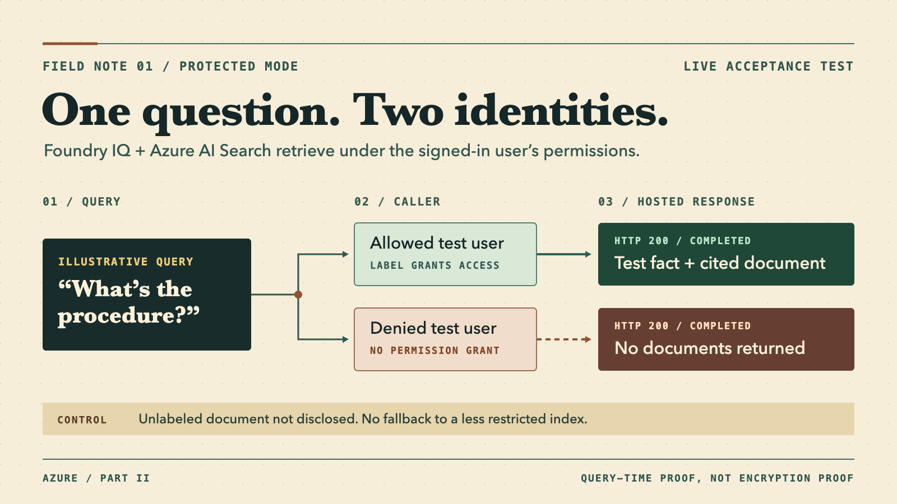
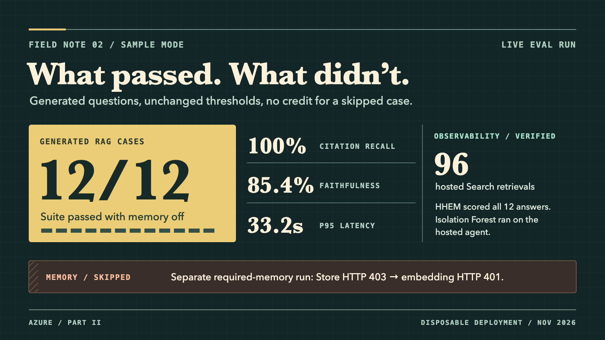

# Same Question. Different Clearance. (Part II)

*I went back to the Azure agent to see what it would remember, what it would refuse to tell me, and what an HTTP 200 was actually worth.*

In [Part I](https://www.linkedin.com/pulse/ai-evaluated-my-interview-so-i-built-same-agent-three-williams-gvq4c/), a two-and-a-half-hour interview turned into the same manufacturing RAG agent on three clouds. I ended by saying I was going to resist the urge to build a fourth version.

Technically, I kept that promise.

I went back to Azure. The agent could already find a maintenance procedure and cite it. What I hadn’t shown was whether it could tell the difference between *finding* a procedure and being allowed to show it to the person asking.

So I asked the same question twice. The important part was that I signed in as someone else the second time.

### Same question. Different clearance.

I set up two test users and two disposable documents. One document had a Microsoft Purview sensitivity label that granted access to one user but not the other. The second document was unlabeled, which gave me a way to test whether the agent would accidentally treat “no label” as “no problem.”

The template provisions dedicated Azure AI Search and private Blob Storage through `azd`. Search indexes the text and labels; Foundry IQ retrieves under the signed-in user’s delegated identity. The hosted agent checks the labels on the references it actually uses. The model doesn’t decide who gets access, and there’s no fallback to a less restricted index if the protected one comes up empty.

The first hosted run got the answer wrong in an interesting way. Search and Foundry IQ gave the allowed user the right document, but the preview response put the label in a different field than the agent expected. The agent refused to use the document. Annoying, but I’ll take that over making up an access policy on the spot.

After fixing the parser for that verified source, the deployment check passed. The allowed user got the test fact and a citation. The other user got no documents. The unlabeled control stayed out of the answer.

*Figure 1. Two signed-in users, one question. This tested query-time access in a disposable environment. It didn’t prove file encryption at rest or validate a production application’s sign-in.*

### I gave the agent a memory. I did not give it a second manual.

In the sample deployment, Azure AI Search is still where the agent gets facts about the equipment. Foundry Memory Store is for remembering things like a user’s preferred checklist format. Those are different kinds of information. If I say I like short answers, that shouldn’t change the lockout procedure.

The preview store uses `text-embedding-3-small`. Memory is scoped to the user and, by default, the session. In optional mode, updates are polled in the background, and reads, writes, and latency are tracked separately from Search. There’s also a two-turn test: tell the agent a preference, then ask a follow-up that depends on it.

That test passed in an earlier live deployment. In the latest one, the store existed and direct embedding calls worked with Microsoft Entra authentication. The store’s own embedding-backed search returned a `403` with a downstream `401`. Apparently the services were acquainted. They were not on speaking terms.

I added a readiness probe that makes the store actually do an embedding-backed lookup. I kept key authentication disabled. The passing run below had memory turned off, so the recall case was **skipped**, not passed. The Purview path is separate and stateless; it doesn’t use Memory Store or the sample eval and telemetry pipeline.

### Congratulations on your HTTP 200

The generated RAG suite uncovered two more ways to be wrong. The hosted URL already selected the agent, but the eval runner was also sending the agent name in `model`, overriding the configured GPT-5 deployment. Then, once the model was reachable, Search ranked the right document and returned a caption that left out the actual procedure. The agent had found the manual and been handed the part that didn’t answer the question.

I removed the model override and kept semantic ranking, but gave the agent bounded text from the indexed documents alongside the captions. I’d already learned the hard way that Foundry can return HTTP 200 with `status=failed` and no answer. The runner now checks for an actual completed response with content before it scores anything.

All 12 generated RAG cases completed without errors, and the suite passed without relaxing its thresholds: **100% citation recall, 80.4% keyword recall, 85.4% faithfulness, and 33.2 seconds p95**. That is not a perfect score, and the latency is something I’d want to bring down before putting this in front of a floor supervisor.

*Figure 2. Sample deployment results. The separate required-memory run hit a Foundry preview authentication error before reaching Search.*

### The graphs weren’t there for decoration

The GPT-5 judge ran. So did HHEM, which checked the answers against the expected source documents. Log Analytics recorded 96 real Search retrievals. I trained Isolation Forest on six features from those records, uploaded the model to private Blob Storage, and verified the hosted agent loaded it and wrote nonzero anomaly scores back to Log Analytics. A trained model in a storage account is a file. I wanted evidence that the agent had actually used it.

Initial training still happens during sample deployment. Retraining is now manual. The Sunday cron has been relieved of its duties.

Both disposable environments came down with `azd down --force --purge --no-prompt`. I checked that no active resources remained. Ending a demo by verifying that the infrastructure no longer exists is not especially cinematic, but neither is finding it on next month’s bill.

The [Azure template](https://github.com/Metafiziks/azd-foundry-search-agent) and its evaluation criteria are public. The most useful answer the agent gave me this time wasn’t a maintenance procedure. It was what happened when I asked for one as someone who wasn’t supposed to see it.

Still only three clouds.
