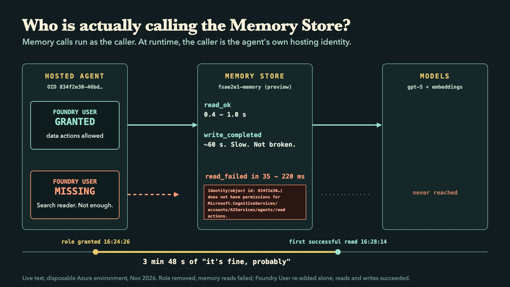

# I Tried to Make My AI Agent Leak a Secret. It Said No. Politely. Twice.

*Part II. Same Azure agent, new hobby: attempting to get it to say things it shouldn't, and then admitting that the "Microsoft bug" I blamed last time had my fingerprints on it.*

In [Part I](https://www.linkedin.com/pulse/ai-evaluated-my-interview-so-i-built-same-agent-three-williams-gvq4c/), an AI evaluated my interview, I responded by building the same agent on three clouds, and I swore I wouldn't build a fourth.

I kept that promise the way people keep a diet: by only touching the Azure one. Then I [gave it memory](https://www.linkedin.com/pulse/i-gave-rag-agents-memory-now-remember-things-which-somehow-even-uytle/), which raised a question I'd been avoiding.

The agent can find any document in the corpus. Wonderful. Can it *not* show me one?

### Two users. One secret. One decoy.

The test is rude in its simplicity. Two test users. Two synthetic documents.

Document one is an Office file carrying a Microsoft Purview sensitivity label whose rights allow User A and nobody else. Document two is unlabeled, contains a *different* fact, and exists purely to find out whether the agent treats "no label" as "no problem."

Then I ask both users the same question. The only variable is who's asking.

Here's how the protected mode (`KB_ACCESS_MODE=purview`) is wired. Azure AI Search gets its own dedicated service with RBAC and no API keys. The Blob container has no anonymous or shared-key access. The indexer pulls the text *and the labels* into the index. Foundry IQ retrieves under the signed-in user's delegated token, so Search sees the person, not the agent. The hosted agent only uses references that carry a valid label. There's no fallback to a friendlier index if the protected one comes up empty.

The model does not decide who gets access. I wanted that decision made by a system with an audit trail, not by a language model with vibes.

### Round one: it refused to help the person it was supposed to help

The first hosted run got the wrong answer in a fascinating way. Search and Foundry IQ handed User A the right document. The preview response put the label in a different field than the agent expected. The agent looked at a document that was perfectly fine, couldn't verify the label where it was looking, and declined to use it.

Irritating? Yes. Also the best possible way for it to be wrong. I will take "refuses to use a document it can't verify" over "makes up an access policy on the spot" every day of the week and twice on Mondays. I taught the parser to accept the label from the verified index field and ran it again.

### Round two: same question, different clearance

*Figure 1. One question, two signed-in users. Query-time access in a disposable environment, not a proof about files at rest.*

User A got the test fact and a citation to the labeled file. User B got a completed response with no documents. The unlabeled control stayed out of every answer.

Then I tried to be annoying. A request with no user delegation: rejected. A stateful request, so the agent might remember and replay something: rejected. An anonymous read straight from Blob Storage, to see if there was a back door around the agent to the file itself: denied.

Usually I treat an HTTP 200 as a suspect. This time the 200 that says "no documents" *is* the passing grade. It's the first time a successful status code has been the sound of a door being locked.

What this doesn't prove, because I'd like you to trust the rest: it checks **query-time** access, not whether the file is encrypted at rest. It was a disposable environment with same-tenant users, not a production app's sign-in. And label changes only reach Search after an indexer run, every two hours by default, so this is not a revocation button. For an urgent removal, take the index out of service and verify.

### Why protected mode has no memory

Protected mode is stateless on purpose: no Memory Store, `store=false`, no conversation, nothing to replay. An agent that remembers a restricted answer and hands it to the *next* person isn't remembering. It's leaking with extra steps.

Memory is for the sample deployment, where the manufacturing docs are public anyway and the worst case is that it knows you like bullet points. Which brings me to the thing I blamed on Microsoft.

### The Memory Store bug had my fingerprints on it

In my own README I'd written up the Memory Store returning a `403` with a downstream `401` and politely suggested that Azure support take a look. Translation: I blamed Microsoft. Easy, satisfying, and a great way to avoid reading my own scripts.

So I reproduced it. I deleted one role assignment, and the agent's memory reads failed in 35 to 220 milliseconds with a refreshingly blunt message: the agent's hosting identity doesn't have permission to read agents. Not a downstream mystery. A missing role.

*Figure 2. The Memory Store runs as the caller, and at runtime the caller is the agent's own identity.*

Memory calls run as whoever is calling, and at runtime that's the agent's own hosting identity. It needs `Foundry User`. "It can already read Search" does not count; I checked. And Azure took **3 minutes 48 seconds** to believe me after I granted it.

Then I read my own post-deploy script. When a role grant failed for *any* reason, it printed a cheerful `already assigned`. Not "failed." Not "oops." Already assigned. My script was a very confident intern who has never once said "I don't know."

I can't prove the original 403 had this exact cause. That environment is gone. What I can say is that I can now produce a memory failure on demand by removing one role, and I found a script that would have hidden it. The fix: real error handling, the deployer gets the role before the readiness probe, and the probe now retries through propagation instead of declaring Azure broken on the first try.

**While I was in there: memory was making the agent slow.** The first full run failed its own latency gate: p95 of 93.5 seconds. Reads were fast. Memory *writes* took 40 seconds on average and up to 63, and in strict mode the agent waited for each one to finish before answering you. I had built an assistant that, in the name of reliability, took a minute to remember you like bullet points before replying. The memory-recall eval case alone took 158 seconds.

Writes now finish in the background. Strict mode doesn't block the response; it fails the *next* request if a write died. The same case now takes 38 seconds.

Also, I had deployed gpt-5 with the default capacity and then asked it to answer, judge, and remember all at once. It rate-limited itself. That's not a bug. That's a lifestyle.

### And then I turned it all off and checked

The whole point of a template is that someone else can run it, so I ran it from scratch, with the fixes, as `azd up`. Then I tore it down with `azd down --purge` and checked that it was actually gone.

- 13 generated evals, all completed, no errors. **Faithfulness 0.96, relevance 1.00, citation recall 1.00, keyword recall 0.91.**
- **p95 latency 40 seconds**, down from 93.5. Still not fast. Under the gate.
- The memory recall case passed with managed memory on, in 38 seconds instead of 158.
- The full `azd up` took about an hour, five minutes of which was provisioning. The rest is hosted build, role propagation, and an eval suite that politely waits 60 seconds between questions.
- IsolationForest trained on 34 real retrievals, and the hosted agent loaded it and wrote a nonzero anomaly score. HHEM scored all 12 answers.
- Teardown: **about two and a half minutes**, twice (2:28 and 2:14). The resource group was gone and the Cognitive Services account was purged both times. I checked, because finding a forgotten AI Search service on next month's bill is not a character-building experience.

*Figure 3. Sample deployment, fresh `azd up`. Run 1 (before the memory fixes) is the grey bar.*

Two honesty notes. I ran the sample path end to end this time, not the Purview test; that one needs a tenant admin, labels, and two real people, and it's documented in the repo. And azd's `--check-status` told me I was "logged in" while the next command told me my login had expired in July. Both said it with total confidence. I've worked with LLMs like that.

The [Azure template](https://github.com/Metafiziks/azd-foundry-search-agent) is public, including [the protected mode guide](https://github.com/Metafiziks/azd-foundry-search-agent/blob/main/guides/purview.md) and the evals.

The most useful thing the agent did this month wasn't answering a question. It was refusing to, on purpose, to the right person.

Still three clouds. Still more discreet than the average Slack channel.
